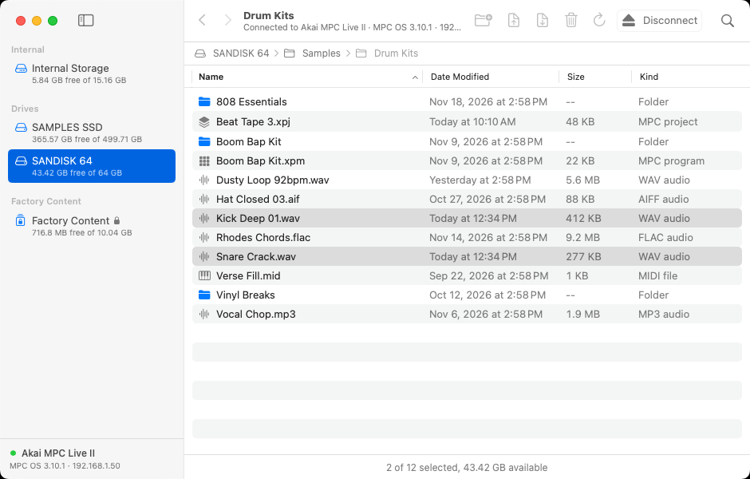
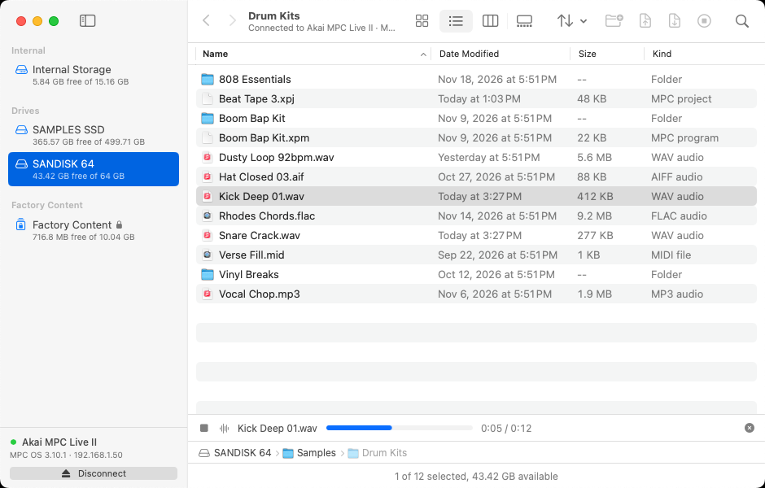
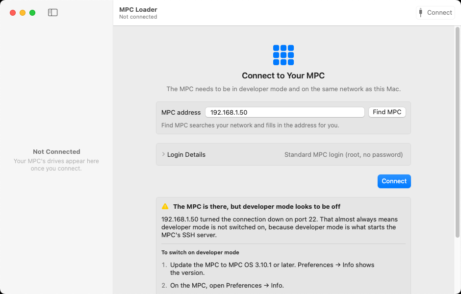
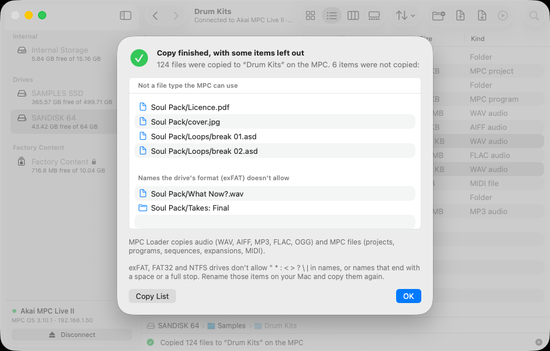

# MPC Loader

A Mac app for copying samples to and from an Akai MPC over your home network. It looks and works like a small Finder window: drives down the side, files in the middle, drag samples in to copy them across.

It talks to the MPC the same way Akai's own [MPC Plugin SDK](https://github.com/inmusic-software/mpc-plugin-builder-sdk) tool does: through the SSH server the MPC starts when you put it in developer mode.

> **Status:** the file handling is tested against a stand-in MPC (a Linux machine set up with an MPC's drive layout, including exFAT and FAT32 drives), and the app builds and starts on macOS. It has **not yet been run against a real MPC**, and its buttons have not been clicked through by a person. Try it first with files you have a copy of.



## What you need

- A Mac running macOS 14 (Sonoma) or later.
- An MPC running MPC OS 3.10.1 or later, in developer mode.
- Both on the same Wi-Fi or wired network.

## Get the app

**Download a build.** Open the repository's Actions tab on GitHub, choose the latest successful *Build* run and download *MPC-Loader-mac*. Unzip it and drag *MPC Loader* into Applications.

The download is not signed with an Apple developer certificate, so macOS will block it the first time. Open it once, then go to System Settings → Privacy & Security and choose *Open Anyway*.

**Or build it yourself.** Download or clone this repository, open Terminal in its folder and, with Xcode or the Command Line Tools installed, run:

```bash
scripts/build-app.sh
```

```bash
open "dist/MPC Loader.app"
```

A build you make yourself is not blocked by macOS.

## Put the MPC in developer mode

These are the steps from Akai's SDK for MPC OS 3.10.1:

1. On the MPC, open Preferences → Info.
2. Tap the version value 3 times, then the serial number value 2 times, then the firmware version once.

Developer mode starts the MPC's SSH server. Menu names can change between MPC OS versions, so check Akai's SDK guide if these don't match your MPC.

Developer mode lets any device on your network log in to the MPC with no password. Switch it off again when you are on a network you don't control.

## Using it

1. **Connect.** Open MPC Loader and click *Find MPC*. It searches your network and fills in the address. If it can't find the MPC, type the address yourself: on the MPC it is under Preferences → Wi-Fi (hold Shift to reach the tab) or Preferences → Ethernet. Then click *Connect*.
2. **Browse.** Pick a drive in the sidebar and double-click folders to open them. The path above the list shows where you are. Click any part of it to jump back.
3. **Copy to the MPC.** Drag files or folders from Finder into the window, or click *Copy to MPC*.
4. **Copy to your Mac.** Drag items out of the window into Finder, or straight into another app that takes files. The copy starts when you drop them. Or select items and click *Copy to Mac*, then choose a folder. Nothing on your Mac is ever replaced: a clashing name gets a number added.
5. **Listen before you copy.** Select an audio file and press the space bar, or double-click it. A small player appears above the status bar. While it is open, the up and down arrow keys step through your samples and play each one. Press space again to stop.
6. **Tidy up.** *New Folder* and *Delete* are in the toolbar. They are also in the File menu and the right-click menu, along with *Rename*.
7. **Disconnect** with the button at the top right when you are done.



The first time it connects, macOS asks whether MPC Loader may find devices on your local network. Allow it, or nothing on the network will answer.

### How Find MPC works

Find MPC checks the other addresses on your Mac's network for a device listening on the SSH port, then asks each one it finds what it is, using the MPC's standard login (`root`, no password). A device that answers as an MPC has its address filled in for you. It runs by itself the first time you open the app, and after that only when you click the button.

It never sends a password you have typed to a device it hasn't identified. If you have set a password on your MPC, Find MPC can't identify it, so type the address yourself. It only searches home and office address ranges, and at most the 254 addresses around your Mac.

### Login details

MPC Loader uses the MPC's standard login: user name `root`, no password, port 22. If you have changed these on your MPC, open *Login Details* on the connect screen and enter your own. A password is stored in your Mac's Keychain.

### If it says developer mode is off

When the MPC is on the network but turns the connection down, the SSH server isn't running. That almost always means developer mode is off, and MPC Loader shows the steps to switch it on.



## What it will and won't touch

MPC Loader only shows the MPC's storage drives. Everything else on the MPC is out of reach, by design.

| Location on the MPC | What it is | Access |
|---|---|---|
| `/media/az01-internal-sd`, `/nvme` | Internal storage | Full |
| Anything else under `/media/` | SD cards, USB drives, a fitted SATA drive | Full |
| `/media/acvs-content`, `/media/acvs-synths` | Factory sounds and synth content | Read-only: copy from, never change |
| `/media/az01-internal` | The MPC's system data (settings, Wi-Fi, passwords) | Hidden and refused |
| Everything else (`/etc`, `/usr`, ...) | The MPC's operating system | Hidden and refused |

Each action is checked twice: once on the Mac against these rules, and again on the MPC itself, which confirms the folder really sits on the drive (so a shortcut on a drive can't lead the app somewhere else) and that the drive is still plugged in before anything is changed. The top folder of a drive can't be deleted or renamed. A drive the MPC has mounted read-only stays read-only.

## Which files get copied to the MPC

Only files the MPC can use are copied. Anything else stays on your Mac, and when the copy has finished MPC Loader shows a list of what was left out and why.

- **Audio:** WAV, AIFF, MP3, FLAC, OGG.
- **MPC files:** projects (`.xpj`), programs (`.xpm`), sequences (`.sxq`), expansions (`.xpn`), MIDI (`.mid`), plus `.xal`, `.xid`, `.mpcpattern` and `.progression`.
- **Older Akai formats the MPC still loads:** `.snd`, `.pgm`, `.akp`, `.all`, `.seq`, `.aps`, `.prj`, `.ipt`, `.50k`, `.50s`.
- **Expansion folders** keep their `Expansion.xml` and cover artwork, and **plugin folders** (a folder holding a `plugin.json`) are copied whole.

Files are also left out when:

- **The drive's format doesn't allow the name.** The MPC formats drives as exFAT, and exFAT, FAT32 and NTFS refuse `" * : < > ? \ |` in names, and names ending in a space or full stop. Rename the file on your Mac and copy it again.
- **The file is over 4 GB and the drive is FAT32.**



Finder clutter (`.DS_Store` and similar) is dropped without comment. The list of file types lives in one place, `Sources/MPCKit/MPCFileTypes.swift`, if you want to change it.

Copying from the MPC to your Mac has no such filter: whatever you select is copied.

## Good to know

- **Copies to the MPC are all-or-nothing per file.** While a file is arriving, the MPC holds it under a hidden in-progress name, and only gives it its real name once every byte has arrived. Cancelling, or losing the connection, never leaves a half-written sample behind, and replacing a file never loses the old one if the copy fails.
- **Previews and drags leave the MPC untouched.** To play a sample or hand a dragged file to Finder, MPC Loader copies it into your Mac's temporary folder and works from there. Nothing is created on the MPC for either. That folder is emptied when you quit the app, and anything a crash left behind is cleared the next time it starts.
- **Previews play what macOS can play:** WAV, AIFF, MP3 and FLAC. macOS has no built-in support for Ogg audio, so an Ogg file can be copied but not previewed.
- **One copy at a time** with the toolbar buttons. Start another once the first has finished.
- **The MPC's identity is not verified.** Like Akai's own tool, MPC Loader does not check the MPC's SSH key, because it changes when the MPC is updated or reset. On a home network that is a reasonable trade. Avoid typing a custom password on a network you don't trust.
- **Not built yet:** dragging items between folders on the MPC to move them.

## For developers

```
Sources/MPCKit      The core: SSH transport, storage rules, file operations, discovery. Builds on Linux too.
Sources/MPCLoader   The SwiftUI app (macOS only).
Tests/MPCKitTests   Unit tests, plus integration tests that run against a stand-in MPC.
scripts/            build-app.sh (makes the .app) and integration-test.sh (the stand-in MPC).
```

Unit tests:

```bash
swift test
```

Integration tests need root, mount rights and an SSH server, so they run in a throwaway container:

```bash
docker run --rm --privileged -v "$PWD":/src -w /src swift:6.0-noble bash -c 'apt-get update -qq && apt-get install -y -qq openssh-client openssh-server busybox-static dosfstools exfatprogs e2fsprogs && scripts/integration-test.sh'
```

They cover GNU and busybox userlands, password logins, awkward file names, cancelled copies, a full drive, a drive pulled out mid-session, and attempts to reach system areas directly or through links.

The screenshots in this README come from the app's demo scenes (`--demo`, `--demo-connect`, `--demo-refused`, `--demo-report`, `--demo-preview`), which show sample content and never touch the network. In a demo, every "file" is a short generated tone, so previewing and dragging out can be tried without an MPC. To refresh them, run the *Build* workflow by hand from the Actions tab.

## Licence and credits

MPC Loader is free software under the [GNU General Public License v3](LICENSE).

The connection method, drive discovery and device-information lookups follow `tools/mpc_remote.py` in Akai's MPC Plugin SDK, which inMusic Brands publishes under the MIT licence. MPC Loader is not made or endorsed by Akai Professional or inMusic. "MPC" and "Akai" are their trademarks.
