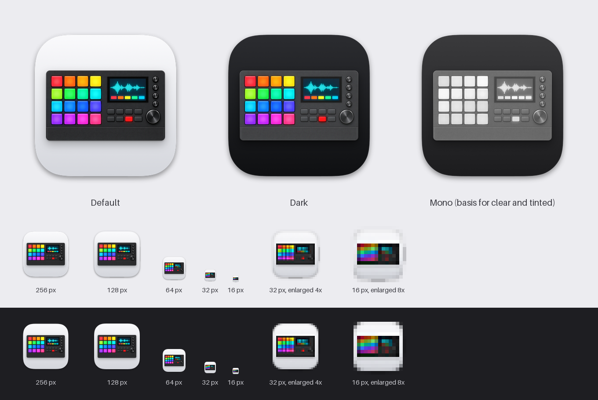

# MPCLoader app icon

A macOS app icon showing an MPC Live II from above: sixteen lit pads, the touchscreen, the four knobs, the data dial and the speaker grille along the front.



## Which file to use

| How you build the app | Use this | What to do |
| --- | --- | --- |
| Xcode 26 or later | `AppIcon.icon` | Drag it into the project. In the target's General tab, under App Icons and Launch Screen, check the App Icon field says `AppIcon`. Xcode also builds the icons that older macOS versions need. |
| Older Xcode | `AppIcon.appiconset` | Drag it into `Assets.xcassets`. |
| No Xcode (Electron, Tauri, a hand-built `.app`) | `AppIcon.icns` | Copy it into `Contents/Resources/` and set `CFBundleIconFile` to `AppIcon` in `Info.plist`. |

Use one route, not several. If a project holds both `AppIcon.icon` and an `AppIcon` set in the asset catalogue, current Xcode uses the `.icon` file and ignores the other.

## What is in this folder

| Item | What it is |
| --- | --- |
| `AppIcon.icon/` | Layered file for Apple's Icon Composer. Holds the default, dark and mono looks. macOS builds the clear and tinted looks from the mono one. |
| `AppIcon.icns` | The classic single-file Mac icon, holding all ten sizes from 16 to 1024 pixels. |
| `AppIcon.iconset/` | The ten PNGs inside the `.icns`, as loose files. |
| `AppIcon.appiconset/` | The same ten PNGs plus the `Contents.json` list Xcode expects. |
| `masters/` | Flat 1024 pixel squares of each look, for a website or a README. |
| `source/` | The artwork everything is built from. |
| `build_icon.py` | Rebuilds every file above from the artwork. |
| `preview.png` | The contact sheet shown above. |

## How it follows Apple's icon rules

Apple now treats a Mac icon as a square, layered design that the system rounds off and lights itself. The `.icon` file follows that:

- A 1024 pixel square, with no rounded corners or shadow drawn in. The system adds both.
- A plain gradient background, set as a fill in the file, not as a picture.
- One foreground layer (the device) with crisp edges and no blur.
- A separate look for dark mode, and a greyscale look that the system uses for the clear and tinted styles.
- No text and no logos.

Mac versions before macOS 26 do not round icons off for you, so the `.icns` and the asset catalogue set are drawn the older way: an 824 pixel rounded square, centred on a 1024 pixel canvas, with a soft shadow beneath. That is the template Apple has used since macOS 11, and newer versions of macOS still accept it.

Sources: Apple's [app icon guidelines](https://developer.apple.com/design/human-interface-guidelines/app-icons) and [Icon Composer guide](https://developer.apple.com/documentation/xcode/creating-your-app-icon-using-icon-composer).

## What has and has not been checked

Checked on the build machine (Linux):

- All ten sizes exist at the right pixel dimensions, with transparent corners.
- Every image inside the `.icns` matches its PNG exactly.
- The asset catalogue list covers 16, 32, 128, 256 and 512 points, each at 1x and 2x.

Not yet checked, because both need a Mac:

- **`AppIcon.icon` has not been opened in Icon Composer.** Apple does not publish the file format, so the file follows a schema worked out by the developer community. If it will not open, start a new icon in Icon Composer, drag in the three PNGs from `AppIcon.icon/Assets/` and set the background gradient by eye. That is about five minutes of work.
- **The icon has not been seen in a real Dock or Finder window.** The preview sheet imitates both.

Two more things worth knowing:

- The artwork in `source/` is the lossless original. A copy also sits in the Creative Claw library as `mpcloader-app-icon-panel-final`.
- The icon carries no Akai name or logo, on purpose. It still pictures another company's product, so check Akai's brand guidelines before publishing the app widely.

## Rebuild

```bash
pip install pillow numpy icnsutil
```

```bash
python3 icon/build_icon.py
```

Background colours, the size of the device and the shadow strength are named settings at the top of `build_icon.py`.

On a Mac you can also rebuild the `.icns` with Apple's own tool:

```bash
iconutil -c icns icon/AppIcon.iconset -o icon/AppIcon.icns
```

## Where the artwork came from

The device illustration was generated with Creative Claw (GPT Image 2.5). `build_icon.py` adds the rounded corners, backgrounds, shadows, the three looks and all the sizes.
